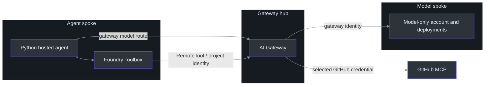
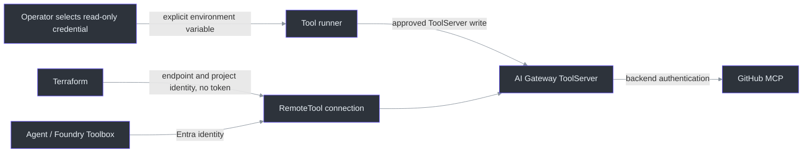

# Implementation Notes

The application retains the original sample's small Python entrypoint.
Terraform modules own the infrastructure; explicit tool and application
helpers keep credentials, deployment receipts and operational actions out
of Terraform's resource graph. Start with the [README](README.md) for setup
and the [staged application guide](infra/docs/application-flow.md) for commands.

## Runtime shape

| Area | Responsibility and source |
|---|---|
| HTTP host | `main` starts `ResponsesHostServer` with an agent factory and agent-server history (`main.py:23`). |
| Model requests | `_gateway_client` selects the gateway route and either API-key or Entra authentication (`repo_digest_agent.py:86`). |
| Tools | `_github_toolbox` uses `FoundryToolbox` with the selected Azure credential (`repo_digest_agent.py:104`). |
| Infrastructure | The composition calls the model, gateway and agent-support modules (`infra/main.tf:28`). |
| Tool connection | Terraform owns the project-managed-identity RemoteTool and requires a gateway-origin endpoint (`infra/connections.tf:5`). |
| Application deployment | `manifest` generates a hosted-agent service and a separately gated routine, not infrastructure provisioning (`infra/scripts/application_flow.py:146`). |

This is the configured application path, not a universal network-isolation
or policy-enforcement guarantee. The actual hosted agent identity is a
postdeployment input; account/project identity grants do not prove that
agent's authorization. Follow the [identity handoff](infra/docs/application-flow.md#3-bind-the-deployed-agent-identity).
The [model profile](infra/model-profile.json) defines the model/alias defaults;
priority tiers do not guarantee error-triggered failover.

## GitHub credential boundary

Terraform does not read or store the selected GitHub token. The independently
invoked [tool runner](infra/scripts/configure_tools.py) reads only the environment
variable named by `--credential-env`; it does not reuse the active GitHub CLI
login. ToolServer creation uploads that selected credential to Azure and
therefore requires separate approval. See the [tool guide](infra/docs/toolchain.md)
for ownership, permissions and the exact operation sequence.

The agent receives gateway/Toolbox configuration, not the GitHub backend
credential. `toolbox_body` exposes the configured read-only tool path without
interactive approval (`infra/scripts/configure_tools.py:499`); this relies on
the operator's separately verified credential restrictions. A repository
prompt, token prefix or `X-MCP-Readonly` header is not a permissions audit.

## Tighten the GitHub credential to least privilege

Choose a credential restricted to the intended repository and read-only
operations. The included advisory validator checks repository access and
Contents, Issues, Pull requests and Actions endpoints
([`github_credential_validator.py`](github_credential_validator.py)); it is
not automatically invoked by the Terraform workflow and cannot certify every
granular permission or the complete selected-repository boundary.

Use the [explicit credential selection and confirmation](infra/docs/toolchain.md)
rather than pasting a token into tfvars, command arguments, a committed file,
the agent's `.env` or a receipt. The helper's read-only confirmation is an
operator attestation. Rotation, inspection and uncertain-write recovery
are separate operations with their own receipts and ownership checks;
do not blindly repeat a failed create.

## Deployment and state boundaries

There is deliberately no checked-in root `azure.yaml`, `agent.yaml` or
`toolbox.yaml`. The helpers generate or submit the appropriate definitions
after matching the applied infrastructure and tool handoffs. Application
preparation copies exactly seven runtime/build files into a private
workspace outside the repository; the allow-list is in
`infra/scripts/application_flow.py:26`.

The generated project disables provisioning/destruction and gates agent
deployment separately from schedule enablement. Terraform does not own those
application/routine operations, the GitHub credential or the Toolbox.
`terraform destroy` is consequently not a complete teardown procedure.
Never disable lifecycle protections or adopt another deployment's state just
to make a command proceed.

## Further reading

| Topic | Guide |
|---|---|
| Modules, state, inputs and outputs | [Infrastructure architecture](infra/docs/architecture.md) |
| Native telemetry stages | [Telemetry handoff](infra/docs/native-telemetry.md) |
| Tool ownership and credential lifecycle | [Toolchain](infra/docs/toolchain.md) and [contract boundaries](infra/docs/tool-credential-boundary.md) |
| Agent, identity and optional routine | [Application flow](infra/docs/application-flow.md) |
| Historical evidence and unresolved safety/403/499 issues | [Acceptance matrix](infra/docs/evidence-map.md) |
