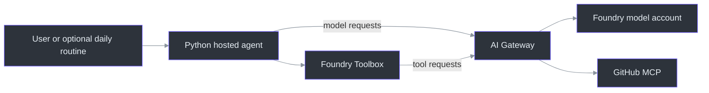
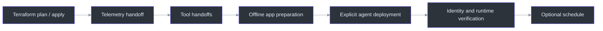

# Daily Repo Digest with AI Gateway - Terraform

A Python Foundry Hosted Agent that creates a repository digest through
**AI Gateway**, using model inference and read-only GitHub MCP tools. This is
the Terraform companion to the [original Azure sample](https://github.com/Azure-Samples/simple-foundry-hosted-agent-python-aigateway):
the application stays at the repository root and infrastructure lives in `infra`.

**Work in progress - November 10, 2026.** This is an initial development
baseline, not a fully qualified release. See the [standalone qualification
status](infra/docs/evidence-map.md#standalone-repository-status): application,
fresh container and Windows/Linux infrastructure CI passed for the initial
commit; Azure runtime acceptance gaps remain open.

**Terraform owns infrastructure.** Explicit helpers configure the GitHub tools
and prepare a separate app-only azd project. There is no root `azure.yaml`,
automatic credential reuse or one-command `azd up` deployment.



The configured paths come from [`_gateway_client` and `_github_toolbox`](repo_digest_agent.py#L86-L108),
the [three Terraform modules](infra/main.tf#L28-L76), and the
[explicit tool handoff](infra/docs/toolchain.md). Policy configuration is not
proof that every policy blocks requests; see [acceptance and limitations](#acceptance-and-limitations).

## Prerequisites

| Work | Tooling and access |
|---|---|
| Application | Python 3.13 and [uv](https://docs.astral.sh/uv/getting-started/installation/); dependencies are frozen in `uv.lock`. |
| Offline infrastructure checks | Terraform 1.11.4, locked AzAPI 2.13.0 and PowerShell 7. No Azure credentials; uncached providers need registry access. |
| Azure deployment | An explicitly selected subscription/tenant, supported regions/models and quota, and existing permissions for the selected resources and scoped role assignments. |
| Hosted application | Stable azd 1.37.x; the accepted baseline used 1.37.2 with the six exact 1.0.0 extensions listed in the [application guide](infra/docs/application-flow.md#prerequisites-and-boundaries). |
| GitHub tools | An explicitly selected read-only credential appropriate for the target repository; see the [credential boundary](IMPLEMENTATION_NOTES.md#tighten-the-github-credential-to-least-privilege). |
| Container smoke checks | Docker running Linux containers. |

These are the sample's compatibility pins, not a claim that arbitrary newer
versions work. Tool installation, authentication and permissions are separate
from the deployment helpers.

## Set up

From a new checkout, restore the application dependencies:

```powershell
uv sync --frozen
```

For a **fresh deployment**, copy `infra\terraform.tfvars.example` to
`infra\terraform.tfvars` and replace its synthetic values. Do not overwrite
existing inputs, copy another deployment's state or reuse its resource names.
For a smaller scenario, select one of the four [independent examples](infra/README.md#start-here)
instead. Use host-native path separators on non-Windows systems.

## Deploy

Follow the [guided application flow](infra/docs/application-flow.md) in order.
It contains the commands, explicit confirmations and receipt checks for each
stage; this overview does not replace those prerequisites.

| Stage | Guide |
|---|---|
| 1. Review and apply infrastructure | [Terraform preparation, state and ownership](infra/docs/architecture.md#offline-and-deployment-preparation) |
| 2. Complete gateway telemetry | [GET-only readiness handoff and second-stage plan/apply](infra/docs/native-telemetry.md) |
| 3. Configure GitHub tools | [ToolServer, Terraform RemoteTool connection, then Foundry Toolbox](infra/docs/toolchain.md) |
| 4. Prepare the application offline | [Copy the seven allow-listed build files to a private workspace](infra/docs/application-flow.md#1-export-and-prepare-offline) |
| 5. Deploy only the agent | [Explicit app-only azd deployment](infra/docs/application-flow.md#2-explicitly-deploy-the-agent) |
| 6. Bind the actual agent identity and verify a digest | [Postdeployment identity handoff](infra/docs/application-flow.md#3-bind-the-deployed-agent-identity) |
| 7. Optionally enable the daily routine | [Separate schedule gate and verification](infra/docs/application-flow.md#4-separately-enable-the-daily-schedule) |



The [application helper](infra/scripts/application_flow.py#L146-L193) generates
the manifest outside this repository. Do not substitute upstream Bicep hooks
or raw `azd up`/`azd down`. `terraform destroy` is not a complete tool,
application or routine teardown, and the gateway has `prevent_destroy`.

## Run locally

Complete the infrastructure and tool handoffs first. Copy `.env.example` to
`.env` without overwriting an existing file, then fill the verified gateway
and versioned Toolbox values. An empty gateway key selects your existing
Entra credential; that principal still needs gateway model access and the
appropriate project/Toolbox permissions. A GitHub token never belongs in the
agent's `.env`. Local requests use Azure and can incur usage.

```powershell
uv run --frozen python main.py
```

In another terminal, use the local console:

```powershell
uv run --frozen python chat.py
```

Set `GITHUB_REPOSITORY` for local requests. For hosted deployment, select
`--repository owner/repository` during application preparation; the generated
routine uses that same selection. A repository prompt is not a permission boundary.

## Validate without Azure

```powershell
pwsh -NoProfile -File .\infra\scripts\Test-Offline.ps1
uv run --frozen python -m unittest discover -s tests -v
docker build --platform linux/amd64 -t repo-digest-terraform:local .
python .\tests\container_smoke.py --image repo-digest-terraform:local
```

[Application CI](.github/workflows/ci.yml) also builds and smoke-tests the
actual prepared application context. [Terraform CI](.github/workflows/terraform-offline.yml)
runs the locked, credential-free contracts on Windows and Linux. Neither
workflow deploys to Azure.

## Repository layout

```text
README.md                       Start here
IMPLEMENTATION_NOTES.md          Architecture and credential boundaries
main.py, repo_digest_agent.py    Python application
github_mcp_middleware.py         Bounded GitHub tool results
Dockerfile, pyproject.toml       Application build and dependencies
tests\                          Application unit tests and container smoke
infra\
  main.tf, variables.tf         Terraform composition and inputs
  modules\                      ai-gateway, foundry-models, foundry-agents
  examples\                     Four independent deployment roots
  docs\                         Staged deployment and acceptance guides
  scripts\                      Offline checks and explicit handoff helpers
  tests\                        Python contracts and mocked Terraform tests
.github\workflows\               Application and Terraform CI
```

## How it works

| Component | Source |
|---|---|
| Responses host | [`main.py:23`](main.py#L23), `main` |
| Gateway model client and Foundry Toolbox | [`repo_digest_agent.py:86`](repo_digest_agent.py#L86), `_gateway_client`, `_github_toolbox`, `build_agent` |
| Infrastructure composition | [`infra/main.tf:28`](infra/main.tf#L28), `foundry_models`, `ai_gateway`, `foundry_agents` |
| Project-owned RemoteTool connection | [`infra/connections.tf:5`](infra/connections.tf#L5), `gateway_remote_tool` |
| Explicit Toolbox definition | [`infra/scripts/configure_tools.py:499`](infra/scripts/configure_tools.py#L499), `toolbox_body` |
| Separately gated agent and routine | [`infra/scripts/application_flow.py:146`](infra/scripts/application_flow.py#L146), `manifest` |

See [implementation notes](IMPLEMENTATION_NOTES.md) for the runtime and
credential flows, and [infrastructure architecture](infra/docs/architecture.md)
for inputs, defaults, module ownership and deliberate differences from Bicep.

## Acceptance and limitations

The [dated acceptance matrix](infra/docs/evidence-map.md) records evidence
inherited from the tested Terraform baseline, not a new live qualification
of this standalone repository. Hosted digests, GitHub tools and correlated
telemetry have demonstrated paths. Safety-denial acceptance, the historical
stored-response 403, recurring MCP 499/authorization error and complete
credential/teardown lifecycle remain unresolved. Do not interpret matching
layout, configured policies or passing offline checks as full E2E acceptance.

The November 10 [native safety support review](infra/docs/evidence-map.md#native-content-safety-support-boundary)
also identifies an explicit upstream unsupported classification for content
safety on the selected gateway resource/API. Retained Medium settings are not
a supported protection guarantee; backend filtering is a separate layer.

Derived from the original sample under the preserved [MIT license](LICENSE).
